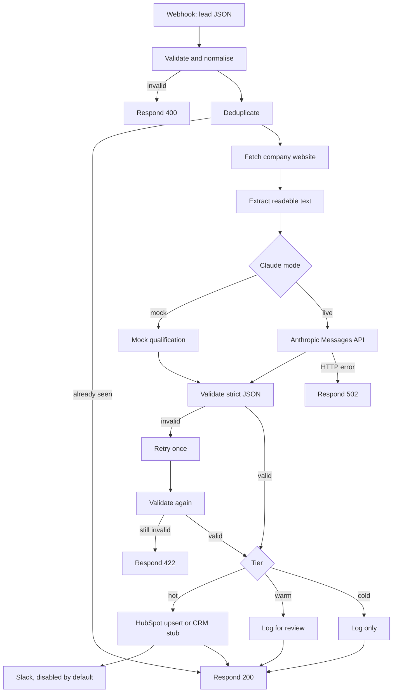

# Lead enrichment and qualification

A lead lands as a name, an email, and a short note. Someone still has to open the company site, decide if the account is worth a call, and copy the result into a CRM. This n8n workflow does that triage. It checks the payload, skips duplicates, fetches the website, and asks Claude for a strict JSON fit score against an ideal customer profile you can edit. Hot leads are upserted to HubSpot, or to a local stub if you have no CRM yet, and can notify Slack. Cold leads are logged. Every path answers the webhook with the outcome.

## Demo

Demo video or GIF: TODO, paste a URL here.

Replace that line with a short recording of one sample lead moving from the webhook to a tier and a CRM stub.

## Architecture



Website fetch failures do not stop the run. The lead is still scored from the notes, and the response says the site could not be read.

## What this demonstrates

- An agentic Claude step with a system prompt, an editable ICP, and a hard requirement for structured JSON.
- Validation of that JSON, one retry that feeds the errors back, then a 422 response if it is still wrong.
- Routing by tier into a CRM upsert, with a stub you can run before HubSpot credentials exist, and a disabled Slack notification.
- Error branches on the website fetch and the Claude calls, a short error log, and a separate error workflow for crashes.
- A webhook response on every path, so the caller is not left hanging.

## Set up in a few minutes

You need Docker, and Node.js 20 or newer if you want the sample script. The default mode does not call Anthropic.

1. Clone the repo and copy the environment file.

   ```bash
   cp .env.example .env
   ```

   Change `N8N_ENCRYPTION_KEY` before you save real credentials. The placeholder is fine for a local mock run.

2. Start n8n. The image is pinned to 2.45.5, the current stable release this sample was checked against.

   ```bash
   docker compose up -d
   ```

   Open http://localhost:5678 and create the owner account when n8n asks. That account stays on your machine.

3. Import and publish the workflows.

   ```bash
   chmod +x scripts/*.sh
   ./scripts/import-workflows.sh
   ```

   The script restarts n8n. A published workflow does not register its production webhook until the process starts again. Running the script twice imports another copy and publishes the newest one.

   Or, in the n8n UI: Workflows, Import from file, choose `workflows/lead-agent.json`, then publish it and restart n8n. Import `workflows/error-handler.json` as well. Open the lead agent, Settings, Error workflow, and select **Lead agent error handler**. n8n stores that link by id, so it cannot be hardcoded in the export.

4. Post the sample leads.

   ```bash
   node scripts/post-samples.mjs --check
   ```

   `scripts/curl-examples.sh` does the same posts without the comparison. The first request sends `x-reset-store: true`, which clears the demo store only while `CLAUDE_MODE` is mock.

The production webhook is `http://localhost:5678/webhook/lead-agent`. There is no authentication on it. Add Header Auth on the Webhook node before this URL is reachable from the internet.

## Sample leads

The five leads in `samples/leads/` are fictional. Companies use reserved example domains. Nobody in those files is a real person, and the LinkedIn fields point at example.com so the repo does not reference a real profile.

| Lead | Expected tier | What it shows |
| --- | --- | --- |
| Northwind Provisions | Hot (86) | CRM stub upsert |
| Lumen Field Services | Warm (64) | Logged for review, not pushed to the CRM |
| Paper Kite Studio | Cold (28) | Logged only |
| Harbour Lane Analytics | Hot (81) | Second hot lead, with a LinkedIn stand-in |
| Brindle Meter | Error 422 | Mock model returns text that is not JSON, twice |

Matching responses are in `samples/outputs/`. They are from mock mode. A live Claude call uses the same JSON shape, but the words and the score will differ. The script also repeats Northwind (duplicate), posts a body with missing fields (400), and posts one lead with `FORCE_MALFORMED_ONCE` to show the retry recovering on the second attempt.

`FORCE_MALFORMED` and `FORCE_MALFORMED_ONCE` are mock-mode test hooks. They are removed from the notes before a live model call.

## Customise the ICP

`prompts/icp.json` is the profile: must-haves, disqualifiers, and the score cutoffs for hot (75) and warm (50). `prompts/system-prompt.md` is the Claude system prompt.

After you edit either file, rebuild the workflow JSON and import it again:

```bash
node scripts/build-workflow.mjs
./scripts/import-workflows.sh
```

The Load config node holds a copy of both files, because an n8n Code node cannot read the repo from disk. You can also paste a quick experiment straight into that node. Re-import overwrites those edits, so keep anything you want to keep in `prompts/`.

Tier rules in the workflow:

- **Hot:** HubSpot when `CRM_MODE=hubspot`, otherwise the CRM stub. Slack is on this branch and disabled.
- **Warm:** logged with action `review`. Connect the warm output of Route by tier to Use HubSpot? if you want warm leads in the CRM too.
- **Cold:** logged with action `log_only`.

## Use a real Claude key

1. In n8n, create a Header Auth credential. The header name is `x-api-key`. The value is your Anthropic API key. Do not put the key in this repo.
2. Open **Claude attempt 1** and **Claude attempt 2**. Replace the placeholder credential `REPLACE_WITH_ANTHROPIC_HEADER_AUTH_ID` with the credential you just created.
3. Set `CLAUDE_MODE=live` in `.env`. Set `CLAUDE_MODEL` if you do not want `claude-sonnet-5-5`.
4. Restart the container so the Code node sees the new environment: `docker compose up -d`.

The response field `model.mode` is `mock` or `live`. `model.envAccess` is false if n8n is blocking environment variables inside Code nodes. This compose file sets `N8N_BLOCK_ENV_ACCESS_IN_NODE=false` so `CLAUDE_MODE` and `CLAUDE_MODEL` can be read.

## Swap HubSpot, the store, or Slack

**HubSpot.** Create a private app token in HubSpot, save it as an n8n HubSpot App Token credential, and select it on **Upsert HubSpot contact** in place of `REPLACE_WITH_HUBSPOT_APP_TOKEN_ID`. Set `CRM_MODE=hubspot` and restart. The node upserts by email and writes first name, last name, company, and website. If HubSpot returns an error, the lead is still logged and the webhook response includes `crm.action: failed`.

**No HubSpot.** Leave `CRM_MODE=stub`. The response carries a stable id such as `stub_mara_ellison_northwind_example`. To use a sheet instead, replace the HubSpot node with Google Sheets, operation Append row, and map `email`, `name`, `company`, `score`, `tier`, `summary`, and `suggestedFirstLine` from the lead and qualification. Disconnect the CRM stub on that branch so you do not double-write.

**Dedup store.** Deduplicate uses n8n workflow static data on this instance. That is the right size for a demo and a single box. For anything shared, create a Data table named `leads` with an `email` column and replace Deduplicate with Data table, Row, If row exists. The false output continues the qualification. The true output joins the duplicate response. Point Log lead at an upsert on the same table if you want the result outside workflow static data. A Google Sheet lookup on email is the same shape.

**Slack.** The node is disabled and pointed at `#leads` with placeholder credential `REPLACE_WITH_SLACK_CREDENTIAL_ID`. Enable it after you attach a Slack access token. If you prefer email, replace the node with Gmail or Send Email and keep it off until the mailbox is ready. It sits beside the hot path, so a notification failure does not change the webhook body.

## Errors

| Situation | HTTP | `error` value |
| --- | --- | --- |
| Missing or invalid fields | 400 | `validation_failed` |
| Model JSON still invalid after one retry | 422 | `model_output_invalid` |
| Tier outside hot, warm, cold | 422 | `tier_unroutable` |
| Claude HTTP failure | 502 | `claude_request_failed` |
| Duplicate email | 200 | none, `duplicate` is true |
| Website down | 200 | none, `website.fetched` is false |

The Code nodes append a short note to `errorLog` in workflow static data (last 50 entries). The executions list in n8n is the full log. The separate error workflow runs only when an execution crashes outside those branches.

## Cost and latency

Anthropic's published list price for Claude Sonnet 5.5 (`claude-sonnet-5-5`) is $2 per million input tokens and $10 per million output tokens. Haiku 5.5 (`claude-haiku-5-5`) is listed from $0.10 and $0.50 if you want a cheaper model for a high volume of leads. Set it with `CLAUDE_MODEL`.

This workflow sends the ICP, the lead, and at most 6,000 characters of website text. That is a few thousand input tokens. The request caps the reply at 4,000 tokens so a model that spends tokens on thinking still has room to finish the JSON. At Sonnet list price, that cap is a few US cents per lead, and a short reply costs less. Confirm a real lead in the Anthropic console before you quote a unit cost. Mock mode makes no Anthropic call.

The webhook stays open until the run finishes (`responseMode: responseNode`). The site fetch gives up after 15 seconds. A Claude call is commonly a few seconds, and longer when the model thinks. The retry adds a second call only when the first JSON fails validation. Mock mode waits on the website fetch and the local checks.

## Project layout

- `workflows/lead-agent.json`: importable lead agent. Credential ids are placeholders.
- `workflows/error-handler.json`: optional error workflow.
- `prompts/`: system prompt and ICP, the files to edit.
- `samples/leads/`: fictional requests.
- `samples/outputs/`: mock-mode responses, including a duplicate and an invalid body.
- `scripts/post-samples.mjs`: posts the samples and compares them.
- `scripts/curl-examples.sh`: the same posts with curl.
- `scripts/build-workflow.mjs`: rebuilds the workflow JSON from `prompts/` and the Code node sources.
- `docker-compose.yml` and `.env.example`: local n8n, no secrets committed.

`npm run check` confirms the workflow graph, the prompt sync, and the fixture JSON. It does not need Docker.

## About me

Charlotte Bakker, automation and integrations specialist.

- GitHub: https://github.com/caebakker
- Upwork: https://www.upwork.com/freelancers/~014229408b7de54f9b
